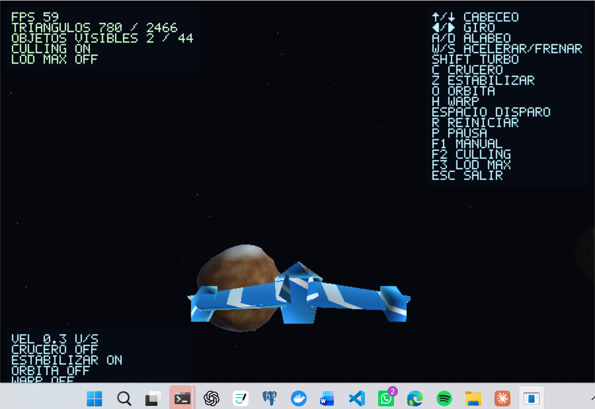

# Fantasticar: Defensa de la Tierra

Proyecto final de Gráficas por Computadora (UVG): sistema solar explorable con
nave, renderer 3D **por software propio** en Rust. Sin motor de juego, sin
funciones 3D/cámara/materiales de GPU: toda la matemática, el pipeline de
rasterización, el z-buffer y los shaders de fragmento son código propio. Las
únicas libs externas son [`minifb`](https://crates.io/crates/minifb) (ventana
e input) y [`rayon`](https://crates.io/crates/rayon) (paralelismo por bandas).

## Integrantes

- Mariana Castañeda
- Antony Saz

## Cómo correr

```
cargo run --release
```

El perfil `release` (`opt-level = 3`, LTO, `codegen-units = 1`) es necesario
para mantener 60 FPS; en modo debug el renderizador por software va notoriamente
más lento. Resolución interna y demás números ajustables viven en
[`src/game/config.rs`](src/game/config.rs).

```
cargo test     # matemática, OBJ, ruido, culling, colisión, física, HUD...
cargo clippy   # sin warnings
```

## Controles

| Tecla | Acción |
|---|---|
| `↑/↓` | Cabeceo |
| `←/→` | Guiñada (giro) |
| `A` / `D` | Alabeo |
| `W` / `S` | Acelerar / frenar |
| `SHIFT` | Turbo |
| `C` | Velocidad crucero (mantiene la velocidad sin mantener `W`) |
| `Z` | Asistencia de estabilización (nivela el alabeo) |
| `O` | Asistencia de órbita (rodea el cuerpo más cercano sin estrellarse) |
| `H` | Warp (impulso extra con estelas animadas en el skybox) |
| `Espacio` | Disparo (proyectil de fuego contra Galactus) |
| `R` | Reiniciar nave |
| `P` | Pausa |
| `F1` | Mostrar/ocultar todo el HUD |
| `F2` | Comparar frustum culling encendido/apagado |
| `F3` | Forzar LOD máximo (comparar contra el LOD normal) |
| `Esc` | Salir |

La tabla de teclas es una sola fuente de verdad en
[`src/game/input.rs`](src/game/input.rs): remapear una tecla es editar esa
lista, y el manual en pantalla (`F1`) se genera a partir de ella, así que
nunca queda desincronizado.

## Qué hay en el sistema solar

Sol + 5 planetas (datos en [`src/game/bodies.rs`](src/game/bodies.rs), todos
orbitan y rotan por tiempo transcurrido, no por frames):

| Cuerpo | Identidad visual | Shader |
|---|---|---|
| Tierra | océanos, continentes, nubes animadas, mapeo de normales de terreno | `shaders/earth.rs` |
| Mundo Forja | lava fluyendo, grietas incandescentes animadas | `shaders/lava.rs` |
| Niflheim | hielo agrietado, frío | `shaders/ice.rs` |
| Planeta Fragmentado | malla deformada por ruido multioctava (geometría rota, no solo color) | `shaders/rocky.rs` |
| Mundo de Plata | metal con circuitos animados | `shaders/metal.rs` |
| Luna | orbita la Tierra, cráteres | `shaders/moon.rs` |
| Sol | plasma turbulento animado, manchas, resplandor | `shaders/star.rs` |
| Galactus | amenaza colosal, malla deformada, persigue a la Tierra | `shaders/galactus.rs` |

Sobre la Tierra hay 4 tipos de modelo propio (árbol cristalino, roca, torre,
baliza) distribuidos proceduralmente con semilla fija
(`SURFACE_SCATTER_SEED` en `config.rs`), orientados a la normal de la
superficie mientras el planeta rota.

## Navegación

- Aceleración, frenado y giro progresivos, independientes del framerate
  (todo integra con delta time, acotado por frame).
- Gravedad por inversa del cuadrado hacia los cuerpos cercanos y colisión
  esférica (la nave no atraviesa planetas: se detiene en el radio + margen
  de seguridad).
- `O` activa un modo de órbita asistida: mantiene una distancia estable al
  cuerpo más cercano para rodearlo sin estrellarse ni cambiar de escena.
- El límite de velocidad baja cerca de un cuerpo, para poder maniobrar en
  superficie sin perder el control.

## Rendimiento

- Rasterización paralela por bandas de framebuffer con `rayon`; buffers
  reutilizados entre frames (sin asignaciones por píxel).
- Frustum culling por esfera y LOD de 3 niveles por distancia, siempre
  activos; `F2`/`F3` los comparan en vivo contra "sin optimizar" y el HUD de
  rendimiento (esquina superior izquierda) muestra FPS, triángulos
  procesados/descartados y objetos visibles/descartados en tiempo real.

## Estructura del código

Arquitectura principal:

```
src/
  main.rs       ventana, bucle principal, delta time
  engine/       motor reutilizable (no depende de game/): math, framebuffer,
                rasterizer, mesh, obj, noise, culling, lod, font, rng
  shaders/      un archivo por shader; trait FragmentShader en mod.rs
  game/         config, cuerpos celestes como datos, nave, cámara, física,
                input, mundo, superficie, combate, HUD
```

## Capturas



## Rúbrica

Las características evaluables y su evidencia están descritas en las secciones
anteriores. El HUD muestra FPS, triángulos, objetos visibles, culling y LOD para
facilitar su verificación durante la demostración.

## Guion del video de entrega

[`GUION_VIDEO.md`](GUION_VIDEO.md).

## Créditos

- Proyecto final del curso de Gráficas por Computadora, Universidad del
  Valle de Guatemala (UVG).
- Geometría de la nave (`assets/models/fantasticar.obj`) y todo el arte
  procedural (shaders, ruido, distribución de superficie) son originales del
  equipo; no se usa ninguna textura ni modelo externo.
- Ambientado libremente en la mitología de Fantastic Four / Galactus, solo
  como inspiración temática para la dirección de arte (sin usar ningún
  asset con derechos de autor de terceros).
- Se utilizó asistencia de IA como apoyo durante la programación y la
  documentación. El equipo revisó el resultado y debe poder explicar y
  modificar el código durante la evaluación.
